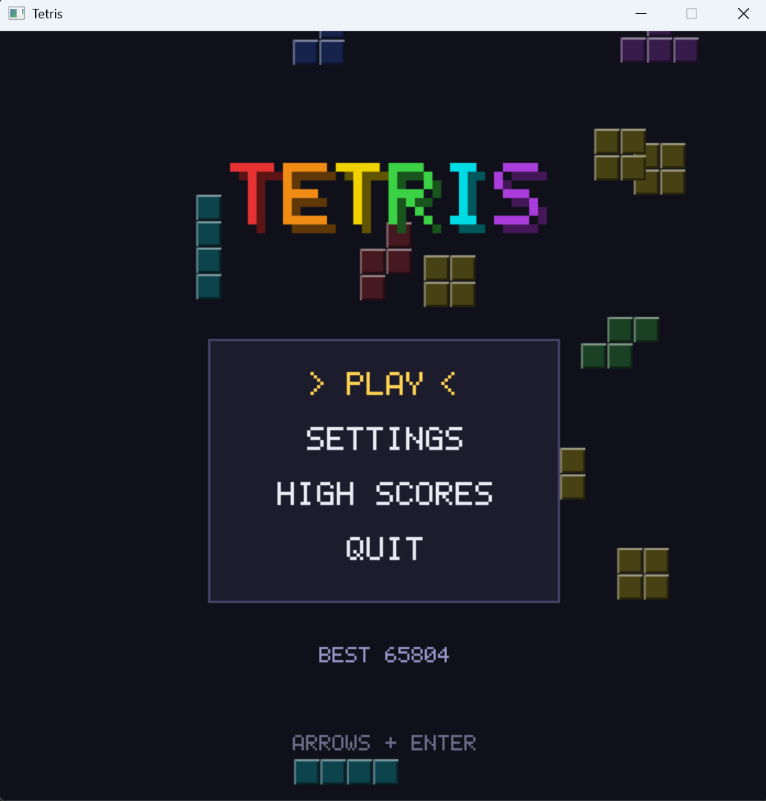

[README.md](https://github.com/user-attachments/files/34286071/README.md)
# Tetris Clone for Windows



A Tetris clone written in C++20 with no external libraries. Everything is built from scratch on top of the C++ Standard Library: the software renderer, the bitmap font, the UI, and the game itself. The only thing outside the Standard Library is a thin platform layer that talks to Windows (`windows.h`) to open a window, read the keyboard, and copy the finished frame to the screen.

## Features

- **Modern Tetris rules:** SRS rotation with wall kicks, a 7-bag randomizer, hold, a 5-piece preview, a ghost piece, lock delay, and DAS/ARR auto-shift.
- **Main menu** with falling pieces in the background.
- **Settings screen** for starting level, ghost piece, handling speed, particles, and screen shake. Settings are saved between sessions.
- **Line-clear animation:** cleared rows flash and wipe out from the center, each block bursts into particles, and a popup shows the clear type and points earned.
- **Screen shake** on big clears and hard drops.
- **High scores:** the top 10 are saved to disk, with arcade-style three-letter name entry.
- **Pause menu** with Resume, Restart, and Main Menu.

## Controls

### In game

| Key | Action |
| --- | --- |
| Left / Right | Move |
| Down | Soft drop |
| Up | Hard drop |
| Space or X | Rotate clockwise |
| Z | Rotate counter-clockwise |
| C | Hold |
| Esc or P | Pause |
| R | Restart |

### Menus

| Key | Action |
| --- | --- |
| Up / Down | Select |
| Left / Right | Change a setting |
| Enter | Confirm |
| Esc | Back (quits from the main menu) |

### Name entry

| Key | Action |
| --- | --- |
| Up / Down | Change letter |
| Left / Right | Move between letters |
| Enter | Save |

## Building

Requires Visual Studio 2026 with the **Desktop development with C++** workload.

1. Create an **Empty Project** (C++).
2. Add the files from `include/` and `src/`, keeping the folder structure.
3. Open **Project → Properties**, set Configuration to **All Configurations** and Platform to **All Platforms**, and set:
   - **C/C++ → General → Additional Include Directories:** `$(ProjectDir)include`
   - **C/C++ → Language → C++ Language Standard:** ISO C++20
   - **Linker → System → SubSystem:** Windows (`/SUBSYSTEM:WINDOWS`)
4. Build and run with **F5**.

No extra libraries need to be linked. `user32.lib` and `gdi32.lib` are part of Windows and are included in Visual Studio's default linker settings.

## Project structure

```
include/
├── app.h                   Owns the shared data and switches between screens
├── engine/
│   ├── canvas.h            Pixel buffer and drawing primitives
│   ├── color.h             Color type and blending
│   ├── font.h              5x7 bitmap font
│   └── input.h             Key state shared by the platform layer and the game
├── game/
│   ├── board.h             The 10x22 grid, collision, and line removal
│   ├── effects.h           Particles, popups, and screen shake
│   ├── gameplay.h          Core game rules and game events
│   ├── highscores.h        Top 10 table, saved to disk
│   ├── piece.h             Piece shapes, colors, rotation, and wall kicks
│   ├── randomizer.h        7-bag randomizer and preview queue
│   ├── scoring.h           Points, gravity curve, and level progression
│   └── settings.h          Player settings, saved to disk
├── platform/
│   └── window.h            Platform interface (window, input, present)
├── screens/
│   ├── game_screen.h       Gameplay, pause, name entry, and game over
│   ├── highscores_screen.h High score table
│   ├── main_menu_screen.h  Main menu
│   ├── screen.h            Screen base class and screen size
│   └── settings_screen.h   Settings menu
└── ui/
    ├── theme.h             Color palette
    └── widgets.h           Text helpers, panels, title, and menus
src/
├── app.cpp
├── main.cpp                Main loop and frame timing
├── engine/                 canvas.cpp, font.cpp
├── game/                   board.cpp, effects.cpp, gameplay.cpp, highscores.cpp,
│                           piece.cpp, randomizer.cpp, scoring.cpp, settings.cpp
├── platform/
│   └── win32_window.cpp    The only file that includes windows.h
├── screens/                game_screen.cpp, highscores_screen.cpp,
│                           main_menu_screen.cpp, settings_screen.cpp
└── ui/                     widgets.cpp
```

## How it works

**Rendering.** Every frame is drawn into a `Canvas`, which is just an array of 32-bit pixels in memory. All shapes, blocks, and text are drawn by writing to that array directly. When the frame is finished, the platform layer hands the array to Windows with a single `StretchDIBits` call to put it on screen.

**Platform layer.** `win32_window.cpp` is the only file that knows about Windows. It opens the window, turns keyboard messages into the `Input` struct, and displays the canvas. Everything else is plain standard C++, so porting to another operating system only means rewriting this one file.

**Screens.** The app is a small state machine. Each screen (main menu, settings, game, high scores) implements `update` and `draw`, and returns which screen to switch to next.

**Game events.** `Gameplay` contains only the rules and knows nothing about pixels. When something happens, such as lines clearing, a hard drop, or a level-up, it records a `GameEvent`. The game screen reads those events each frame and turns them into particles, popups, and screen shake. This keeps the game logic separate from the visual effects.

## Scoring

| Action | Points |
| --- | --- |
| Single | 100 × level |
| Double | 300 × level |
| Triple | 500 × level |
| Tetris | 800 × level |
| Soft drop | 1 per row |
| Hard drop | 2 per row |

The level goes up by one every 10 lines, starting from the level chosen in Settings. Pieces fall faster at each level, following the Tetris guideline gravity curve, up to level 20.

## Save files

The game creates two plain-text files in its working directory:

- `settings.cfg` stores your settings as `key=value` lines.
- `highscores.txt` stores the top 10 scores, one per line, as name, score, level, and lines.

When you run from Visual Studio, the working directory is the project folder. When you run the `.exe` directly, the files are created next to it. Delete either file to reset it.
